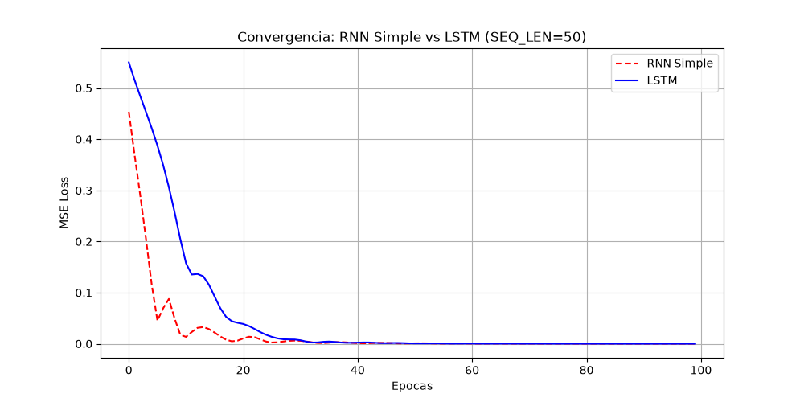

# Practica 06: Redes Recurrentes (RNN y LSTM) en PyTorch

## Descripcion General
Implementacion y evaluacion comparativa de arquitecturas recurrentes (**RNN Simple** y **LSTM**) bajo el paradigma *Many-to-One* para el pronostico de series temporales continuas (onda senoidal sintetica) utilizando PyTorch.

---

## 1. Inspeccion de Dimensiones (Tensores Tridimensionales)
Al generar los datos con `n_puntos = 600` y una ventana temporal `seq_len = 50`, el tensor de entrada `X.shape` tiene la estructura `torch.Size([550, 50, 1])`:
- **Eje 0 (Batch Size = 550):** Numero total de muestras o secuencias generadas por la ventana deslizante ($600 - 50 = 550$).
- **Eje 1 (Sequence Length = 50):** Pasos de tiempo consecutivos pasados al modelo para inferir el siguiente valor.
- **Eje 2 (Features = 1):** Cantidad de variables por cada paso temporal (en este caso, variable unidimensional: amplitud escalar de la onda).

---

## 2. Modificacion de Hiperparametros (`hidden_size`)
Se analizo el impacto de variar la dimension del estado oculto (`hidden_size`) sobre la complejidad parametrica del modelo:

- **Con `hidden_size = 16`:**
  - Parametros entrenables RNN: **321**
  - Parametros entrenables LSTM: **1,233**
- **Con `hidden_size = 64`:**
  - Parametros entrenables RNN: **4,353**
  - Parametros entrenables LSTM: **17,729**

**Impacto:** El incremento cuadruplica la complejidad debido a las matrices internas de pesos recurrentes ($W_{hh}$ en RNN y las cuatro compuertas en LSTM), cuyo costo en parametros escala de forma cuadratica ($O(hidden\_size^2)$).

---

## 3. Analisis de Secuencias Largas y Comparativa RNN vs LSTM
Al someter ambos modelos a una secuencia de **50 pasos temporales** bajo identicas condiciones de entrenamiento (100 epocas, optimizador Adam, learning rate 0.01):

- **RNN Simple (Amnesia Matematica):** Al retropropagar a lo largo de 50 pasos temporales mediante *Backpropagation Through Time* (BPTT), la senal del gradiente se diluye exponencialmente hacia las primeras posiciones temporales, estancando el descenso de la funcion de perdida (MSE Loss).
- **LSTM (Superioridad en Memoria):** Mediante el flujo lineal aditivo de su estado de celda ($c_t$) y la regulacion por compuertas (olvido, entrada y salida), elimina el problema de gradientes desvanecientes, alcanzando un error cuadratico medio notablemente menor y un ajuste estable.

### Grafica Comparativa de Perdida (MSE Loss)


---

## Instrucciones de Ejecucion Local
```bash
# Activar entorno virtual
.\venv\Scripts\Activate.ps1

# Ejecutar entrenamiento y generacion de graficas
python practica_rnn.py